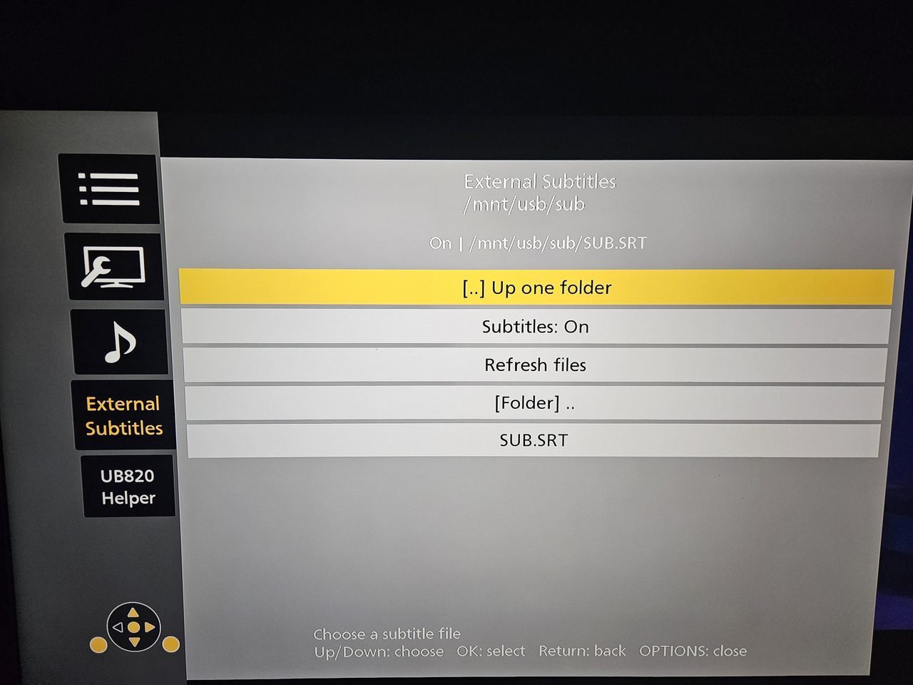
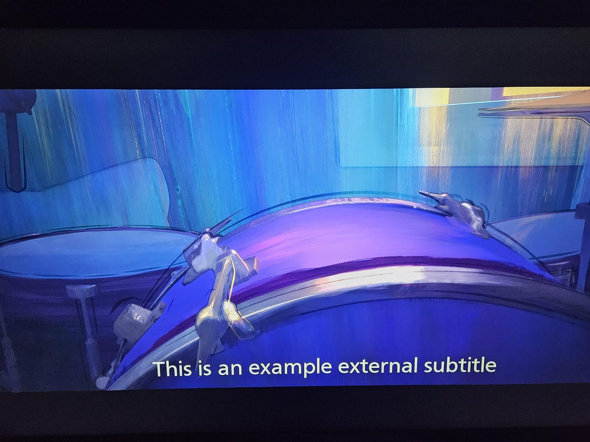
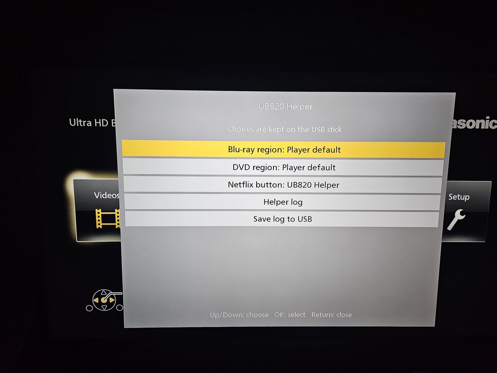

# UB820 Helper

External `.srt` subtitles and extra settings for the **Panasonic DP-UB820**,
with support for firmware **1.82** and **1.85**. The helper runs in RAM;
saved preferences stay on the USB stick. It does not install custom firmware.

Choose subtitle files during playback and adjust their size, position, timing
and brightness. **UB820 Helper** adds disc region choices and other settings.
The Netflix button opens Helper over the home screen, menus or a film.
On remotes without that button, use **Player Settings > System > UB820 Helper**.

[Download 0.2 and release notes](https://github.com/troleqmaster816/ub820-external-subtitles/releases/tag/v0.2)
· [Configuration](USB-CONTENTS/sub/modules.cfg)

| | |
| --- | --- |
|  |  |
| Browse folders in **OPTIONS > External Subtitles** | The selected subtitle file during a film |

## Setup

You need a **FAT32 USB stick** and a DP-UB820 running supported firmware.
For a first install, use the repository's `USB-CONTENTS` folder; the release
ZIP only updates an existing stick.

1. Copy the contents of [`USB-CONTENTS/`](USB-CONTENTS) to the stick's root.
   Keep `LOADER.MKV` beside the `sub` folder.
2. Put your `.srt` files anywhere on the stick. Subfolders work.
3. Start with a fresh player session. If Quick Start is enabled, unplug the
   player briefly before starting it again.
4. Insert the stick, choose **USB > Video**, and launch `LOADER.MKV`.
   The player reports that the file cannot be opened; dismiss the message.
5. Play a disc and open **OPTIONS > External Subtitles** to choose a file.

The helper runs until the player fully restarts; standby with Quick Start
may keep it running. Leave the stick connected while using external subtitles
or saving settings.

### Updating an existing stick

The release ZIP contains the updated `sub` files, not the loader. Replace
**`sub/engage`**, keep your existing configuration and SSH credentials, and
fully restart the player before launching the helper again. The included
`modules.cfg` is a fresh-default example; you do not need to replace your own.

## External subtitles

Open **OPTIONS > External Subtitles**, browse to an `.srt` file and press **OK**.
The file starts at the current film position. Selecting it again reloads it.
**Subtitles: Off** hides external subtitles without changing the disc's own track.

The player's **Subtitle Settings** page also offers size, position,
synchronization and character-code controls for external subtitles. English
labels fill in text missing from the firmware's European menu languages.

**Text brightness** is in the **External Subtitles** menu:

- **Left / Right:** change by 1 point. **Up / Down:** change by 10.
- Changes appear immediately, including while paused.
- **OK:** save. **Return:** restore the value from before editing.
- **Reset text brightness:** restore and save **Original (100%)**.

Lower values darken the text and keep its black outline. **0% draws black
text**; use **Subtitles: Off** to hide it. This control is separate from the
player's **Subtitle Luminance** setting for disc subtitles.

Fractional subtitle timing is enabled by default, avoiding the stock engine's
whole-second timing steps.

## UB820 Helper

Open Helper from **OPTIONS**, **Player Settings > System**, or the **Netflix**
button. Press Netflix again or **Return** to close the overlay.

<p align="center">
  
</p>

| Setting | What it does |
| --- | --- |
| **Blu-ray region** | Choose **Player default**, **A**, **B**, **C** or **A+B+C**. Applies when the next disc starts; eject and reinsert the current disc to apply it. |
| **DVD region** | Choose **Player default**, **No region check**, **Auto** or a region from **1** to **8**. The drive may still refuse an encrypted DVD from another region. |
| **Netflix button** | Open Helper, open Netflix, or do nothing. |
| **Auto power-off** | Keep the player's automatic idle shutdown or turn it off. Manual power-off still works. |
| **CPU optimization** | Optional, experimental reduction of background CPU use. Available only when the `cpu` module is enabled. |
| **Start SSH / Stop SSH** | Available when the `ssh` module is enabled. |
| **Helper log / Save log to USB** | Read recent messages or save them to the stick. |

Menu choices are saved in **`sub/ub820_menu.cfg`**. If saving fails, the menu
says so; the new setting may last only until the player restarts.

## Configuration

Edit [`sub/modules.cfg`](USB-CONTENTS/sub/modules.cfg) to enable modules or
change their starting settings. Restart the player and load the helper again
after editing it. Preferences already saved through the menus take precedence;
remove `sub/ub820_menu.cfg` to return all preferences to the file's defaults.

The supplied defaults enable external subtitles, Helper menus, region controls,
the Netflix shortcut and the helper log. Regions stay at **Player default**,
text brightness is **100%**, and automatic idle shutdown stays **On**.
**The SSH and CPU modules, CPU optimization and detailed diagnostics are off.**

### CPU optimization

To show the control in Helper, set:

```ini
[cpu]
enabled=1
optimize=off
```

Then choose **CPU optimization > On** in Helper. The choice is saved, so it
will apply the next time you load the helper. **Off** restores the original
CPU behavior; the inactive kernel component remains in RAM until a full restart.

This is experimental. Short tests on 1.82 covered menus, the remote, the front-panel
Eject button, Blu-ray playback, external subtitles, pause, seeking and chapters.
Long playback, power/standby and CEC still need testing. CPU optimization has
not been tested on a 1.85 player.

### SSH

Set `enabled=1` under `[ssh]` in `modules.cfg`, put your public key in
`sub/authorized_keys`, then restart the player and load the helper.
Choose **Start SSH** in Helper. It shows the address to use:

```sh
ssh -p 2222 root@PLAYER_IP
```

SSH includes a shell, a home folder in RAM, common tools, SFTP and SCP.
Files in that home folder disappear after a full restart. Optional password
login and automatic startup are described in
[`modules.cfg`](USB-CONTENTS/sub/modules.cfg). Automatic startup begins when
the helper launches, not when the player powers on. Keep SSH on a trusted network.
See the [SSH documentation](source/tools/ssh/README.md) for tool paths and builds.

### Logging

By default, use **Save log to USB** when you need a log. For automatic saving:

```ini
[log]
save=always
```

Logs go to `sub/ub820_submenu.log`; the previous session is kept as
`sub/ub820_submenu.prev.log`. If it cannot preserve the previous log there,
the helper uses a separate filename and reports it. Set `diagnostics=1` for
player crashes, stuck threads and kernel messages. Logging begins with the helper.

## Compatibility and limits

- **1.82:** used for development and player testing.
- **1.85:** a user confirmed external subtitles and menus on a newer **AG**
  player. That report predates the new 0.2 features; it does not verify every module.
- **Other firmware:** patching requires recognized program and library versions.
  Firmware **1.84 is not supported**.
- The new brightness control and latest changes to reduce CPU use while subtitles
  are off or playback is paused have passed local tests; their player tests are
  still pending.
- Experimental automatic Blu-ray region selection is off by default and does
  not handle region checks written in BD-J. Choose a region letter for those discs.
- The file browser shows up to **64 entries per folder** and supports full paths
  up to **250 bytes**. The selected subtitle file is remembered for that playback.

## Troubleshooting

- **Helper is missing from Player Settings.** Close Settings and open it once
  more. If it is still missing, fully restart the player and load the helper again.
- **Changes in `modules.cfg` are ignored.** Saved choices in `sub/ub820_menu.cfg` override
  `modules.cfg`. Both files are read when the helper starts.
- **No log appears on the stick.** Choose **Save log to USB**, or enable
  `save=always`. Check the on-screen helper log for a save error or alternate filename.
- **Something freezes or behaves incorrectly.** Save the log if possible.
  Fully restart the player without loading the helper to return to normal firmware.

## Source and license

See [CONTRIBUTING.md](CONTRIBUTING.md) for building and module development.
The prebuilt helper is `USB-CONTENTS/sub/engage`.

The helper is [MIT-licensed](LICENSE). Bundled components retain their own
licenses: [SSH tools and BusyBox](source/tools/ssh/README.md),
[CPU kernel component](source/modules/cpu/kernel/README.md), and
[GNU C Library](source/licenses/README.md).
This is an unofficial project, not affiliated with Panasonic.
