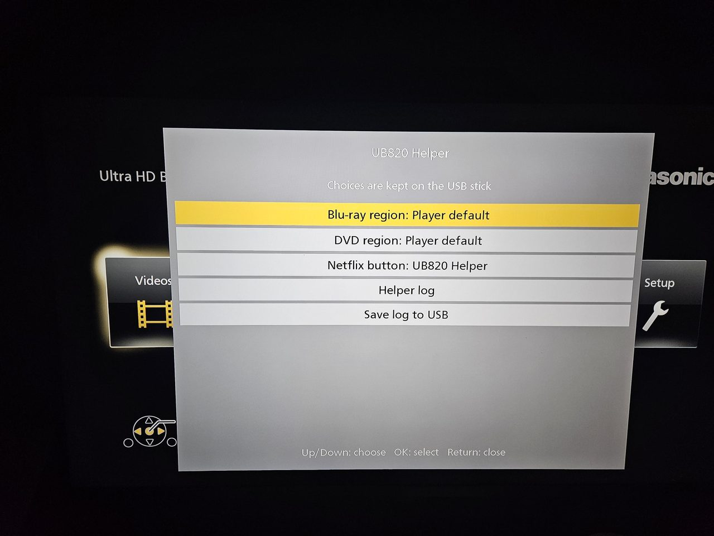
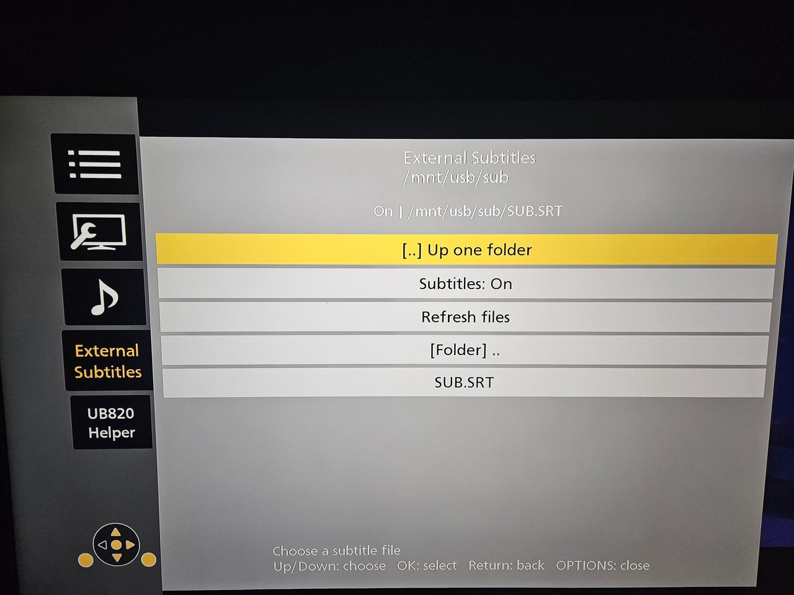
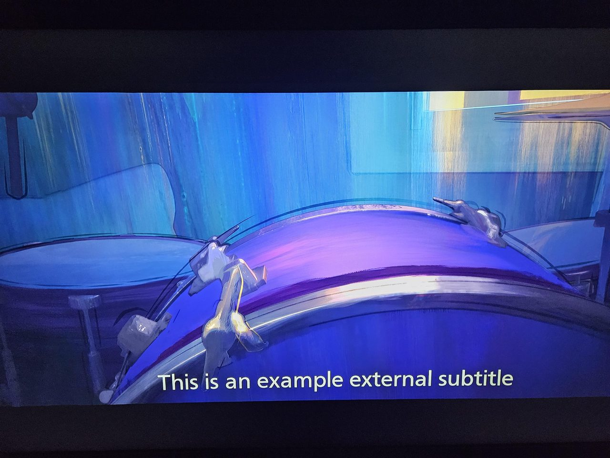
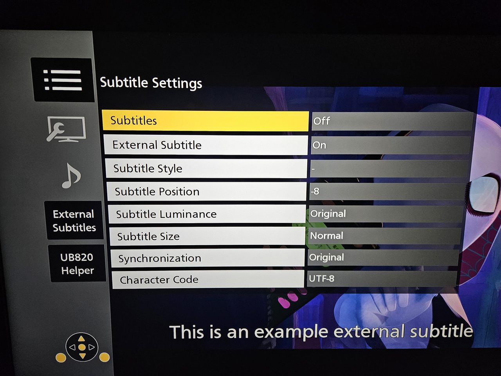
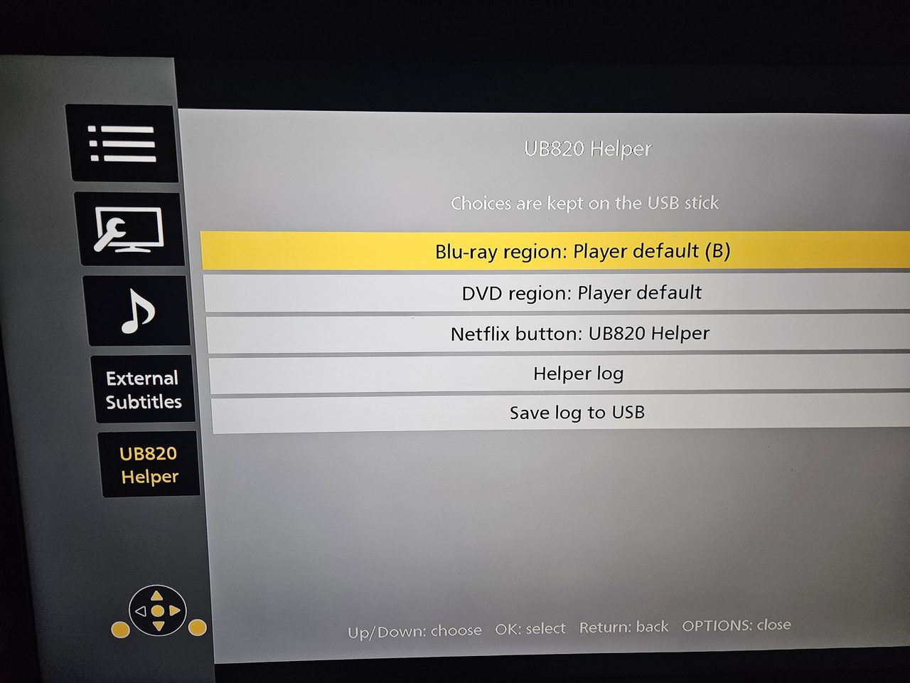
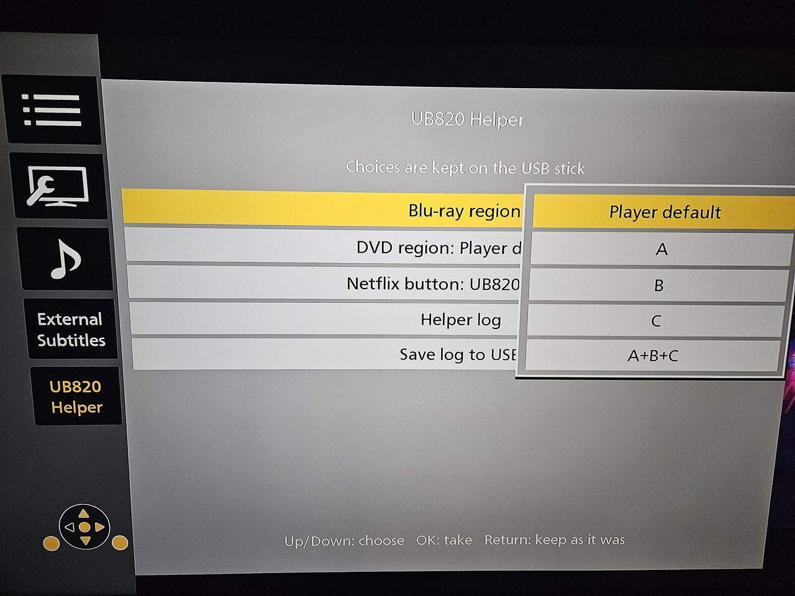

# UB820 Helper

A RAM-only, modular add-on for the **Panasonic DP-UB820** Ultra HD Blu-ray
player (firmware **1.82**, and **1.85**). It adds external `.srt` subtitles,
a **UB820 Helper** menu in OPTIONS and in Player Settings, Blu-ray and DVD
region choices, a configurable Netflix button and a few diagnostic tools.
Nothing is written to flash, EEPROM or the drive: a full power cycle removes
everything.

> [!TIP]
> **Press the Netflix button on the remote** and the **UB820 Helper** window
> opens over whatever is on screen: the home screen, a menu or a film. Press
> it again, or Return, to close it. This is the default; the button can also
> be set back to Netflix or to do nothing.

<p align="center">
  
</p>

Each feature is a separate module that you can switch on or off in one
settings file, and new modules can be added without touching the others.

> [!NOTE]
> Developed and tested on a DP-UB820 with firmware 1.82. Support for 1.85 is
> built from a comparison of the two firmware versions and has not been
> confirmed on a 1.85 player yet. This is an unofficial project with no
> affiliation to Panasonic.

## Contents

- [Features](#features)
- [Screenshots](#screenshots)
- [Requirements](#requirements)
- [Installation](#installation)
- [Using the menus](#using-the-menus)
- [Configuration](#configuration-submodulescfg)
- [Firmware support](#firmware-support)
- [How it works](#how-it-works)
- [Building from source](#building-from-source)
- [Known limitations](#known-limitations)
- [Troubleshooting](#troubleshooting)
- [License](#license)

## Features

| Module | What it does | Default |
| --- | --- | --- |
| `external_subtitles` | External `.srt` subtitles from the USB stick, chosen during playback in OPTIONS > **External Subtitles**: browse folders, pick a file, switch On/Off. Disc-like look (white text, neutral black outline, stable bottom line). Also unlocks the player's own hidden subtitle rows in OPTIONS (size, sync, character code, on/off), with English text where the firmware has no translation. | on |
| `ui` | The menus: **External Subtitles** and **UB820 Helper** in OPTIONS, and the same UB820 Helper as a tile in **Player Settings > System**, reachable without a disc. | on |
| `region` | **Blu-ray region** the disc sees (fixed A/B/C or all three; an experimental `auto` is off by default). **DVD region**, best effort (no region error, or a fixed region 1-8). Region diagnostics in the log. | on |
| `remote` | What the remote's **Netflix** button does: open Netflix as usual, nothing, or open the UB820 Helper menu as an overlay anywhere (home screen, menus, playback). | on |
| `log` | The helper log: level, saving it to the stick (on request or continuously), and optional detailed diagnostics of the player (crashes, hangs, kernel messages). | on |
| `ssh` | An **on-demand** diagnostic SSH server (Dropbear), started from the menu. Key or password login. | **off** |

## Screenshots

Photos of a DP-UB820 with the English menu language.

| | |
| --- | --- |
|  |  |
| **External Subtitles** in OPTIONS: browse the stick and pick a `.srt` file | The chosen file on screen, in the disc-like style |
|  |  |
| The player's hidden subtitle rows (size, position, sync, character code), unlocked | **UB820 Helper** in OPTIONS, shown as soon as its tile has the focus |
|  |  |
| Choosing the Blu-ray region from a list | The same menu as an overlay, opened with the Netflix button |

## Requirements

- A Panasonic DP-UB820 with firmware **1.82** or **1.85**. Every module
  checks the exact SHA-256 of each program it changes and leaves anything
  else alone; on any other firmware the helper changes nothing.
- A USB stick formatted as **FAT32**.
- A way to launch the loader file from the stick with the player's usual
  loader start-up procedure.

## Installation

1. Copy **the contents** of [`USB-CONTENTS/`](USB-CONTENTS) to the **root** of
   the USB stick, keeping the `sub` folder:

   ```
   USB root
   ├── LOADER.MKV            loader (launch this one)
   └── sub/
       ├── engage            the helper: all modules + RAM loader
       ├── modules.cfg       settings: which modules run, and their options
       └── sub.srt           default subtitle used by the player (fallback)
   ```

   Put your own `.srt` files anywhere on the stick; subfolders work.

2. **Fully power-cycle the player** (unplug it, or turn Quick Start off), so
   the helper starts fresh. Standby keeps whatever already runs in RAM.
3. Insert the stick and launch `LOADER.MKV`. The player then says
   the file cannot be opened. This is expected: the file only starts the
   helper and has nothing to play. Dismiss the message.
4. The helper is now running until the next power cycle. Start a disc and
   press **OPTIONS** to find **External Subtitles** and **UB820 Helper**, or
   open **Setup > Player Settings > System > UB820 Helper** without a disc.

## Using the menus

| Key | Action |
| --- | --- |
| Up / Down | move between rows (scroll in the log view) |
| OK / Right | enter the page; then open a folder, select a file, open a list, run an action |
| Return / Left | close a list or the log view, then go back to the tile |
| OPTIONS | close everything as usual |

As with the player's own categories, a page is shown as soon as its tile on
the left has the focus; OK or Right moves into it.

A row with several values (Subtitles On/Off, Blu-ray region, DVD region,
Netflix button) opens a list beside it with the current value highlighted:
**OK** takes the highlighted one, **Return** keeps the old one.

**External Subtitles** (OPTIONS, during playback). The header shows the
current folder and state, for example `On | /mnt/usb/SUB/movie.srt`. Rows:
**[..] Up one folder**, **Subtitles: On/Off**, **Refresh files**, then the
subfolders, then the `.srt` files. A chosen file takes over at the current
film position; choosing it again re-reads it.

**UB820 Helper** (OPTIONS, Player Settings > System, or the Netflix button):

- **Blu-ray region**: **Player default** (default), **A**, **B**, **C** or
  **A+B+C** (and **Auto** when `bd_auto=1`). The row says what the disc in
  the drive sees, e.g. `A (this disc still: B)` until the next disc. A new
  choice applies from the next disc on.
- **DVD region**: **Player default** (default), **Auto**, **No region
  check**, or a region **1**-**8**. Applies within a second; restart a DVD
  that already stopped with a region error. See [the limits](#known-limitations).
- **Netflix button**: **UB820 Helper** (default), **Netflix** or **Does
  nothing**. **UB820 Helper** opens this menu as an overlay wherever you are,
  and Return or the Netflix button closes it. While the overlay is open the
  remote only works the overlay.
- **Start SSH** / **Stop SSH**, when `[ssh]` is enabled.
- **Helper log**: the last lines of the helper log, on screen.
- **Save log to USB**: writes the log to `sub/ub820_submenu.log`. With
  `save=always` the row only says that this happens automatically.

Choices made in the menu are saved on the stick in `sub/ub820_menu.cfg`.

## Configuration: `sub/modules.cfg`

The helper reads this file once at start; power-cycle and launch the loader
again after editing it. Each `[section]` is one module, and `enabled=0`
switches it off. Choices made in the UB820 Helper menu are saved to
`sub/ub820_menu.cfg`, which is read after `modules.cfg` and wins; delete it to
go back to `modules.cfg` alone. Invalid or out-of-range values are ignored
(the default stays) and noted in the log as `config:` lines.

### `[external_subtitles]`

| Key | Default | Values | Meaning |
| --- | --- | --- | --- |
| `font_percent` | `122` | 90 to 150 | Font scale. |
| `position` | `-8` | -10 to 10 | Vertical step; lower numbers move the text down. |
| `bottom_align` | `1` | 0 or 1 | `1` keeps one- and two-line cues on the same bottom line; `0` is the stock behaviour. |
| `native_options` | `1` | 0 or 1 | The player's own size, sync, character code and on/off rows in OPTIONS. |
| `english_text` | `1` | 0 or 1 | English text for those rows in menu languages where the firmware has none. |

The player's own subtitle position and size settings keep working.

### `[region]`

| Key | Default | Values | Meaning |
| --- | --- | --- | --- |
| `bd_region` | `stock` | `stock`, `A`, `B`, `C`, `ABC`, `auto` | Region a Blu-ray sees. `stock` leaves the player alone; `A`/`B`/`C` force one region; `ABC` sets all three bits (only for discs that test a bit mask); `auto` needs `bd_auto=1`. |
| `bd_auto` | `0` | 0 or 1 | Experimental: allows `bd_region=auto`, which keeps the player's region unless the disc's HDMV program accepts only other regions (discs that check in Java, BD-J, keep the player's region). With 0, `auto` is not offered in the menus and counts as `stock`. |
| `dvd_region` | `stock` | `stock`, `free`, `1`-`8`, `auto` | DVD region, best effort. `free`: a disc is never stopped with a region error; `1`-`8`: also the region discs see; `auto`: no region error, and a disc that excludes the player's region sees the first one it allows. |

### `[remote]`

| Key | Default | Values | Meaning |
| --- | --- | --- | --- |
| `netflix_key` | `helper` | `helper`, `netflix`, `nothing` | What the Netflix button does. `nothing` drops the key the way the firmware does on models without Netflix; `helper` opens and closes the UB820 Helper overlay. |

### `[log]`

| Key | Default | Values | Meaning |
| --- | --- | --- | --- |
| `level` | `info` | `errors`, `info`, `debug` | Detail of the helper log. Errors are always kept. |
| `save` | `menu` | `off`, `menu`, `always` | When the log goes to `sub/ub820_submenu.log`: `menu` when you choose **Save log to USB**; `always` a few seconds after each change and at once after a crash report, keeping the previous run's log as `sub/ub820_submenu.prev.log`; `off` never. |
| `diagnostics` | `0` | 0 or 1 | Detailed diagnostics of the player itself: crash reports, stuck or spinning threads, programs starting and ending, kernel messages, low memory, and a load line every minute. Best with `save=always`. |

### `[ssh]`

| Key | Default | Values | Meaning |
| --- | --- | --- | --- |
| `enabled` | `0` | 0 or 1 | `1` adds **Start SSH** to the UB820 Helper menu. Nothing listens until you start it there. |
| `auth` | `key` | `key`, `password` | `key`: log in with a key whose public half is in `sub/authorized_keys` on the stick. `password`: the password is the one line in `sub/ssh_password` on the stick. |
| `port` | `2222` | 1024 to 65535 | TCP port. |
| `guard` | `0` | 0 or 1 | Logs every program a session starts, and ends a session whose shells keep starting each other. Diagnostic. |

Connect with `ssh root@<player-ip> -p 2222`; the menu shows the exact line
after you start the server. **Key login is recommended.** With a password,
it sits in clear text on the stick (the helper hands Dropbear only a `$6$`
hash), and the player has no firewall, so anyone on your network can reach
the port. The server runs only after you start it and is gone after a power
cycle.

## Firmware support

| Firmware | Status |
| --- | --- |
| 1.82 | Everything; tested on a player. |
| 1.85 | Everything except the English text of the native subtitle rows (the firmware's language file changed); not yet confirmed on a player. |
| other | Nothing is changed. |

For 1.85, programs that are byte for byte the same as in 1.82 take the 1.82
code as it is; `apl_bdv` keeps its code and only its region data moved;
`apl_mgr` and `apl_setting` changed, so their payloads carry their own 1.85
addresses, each one checked against the 1.82 machine code. Every decision is
in the helper log. Expected hashes are in the module manifests
(`source/modules/*/*.json`) and in [`source/core/injector.c`](source/core/injector.c).

## How it works

```
LOADER.MKV          ──► starts sub/engage (core + modules, static ARM binary)
                            │
                            ├─ ui: menu payload               ──► apl_dispsrv      (OPTIONS menus, overlay)
                            │      settings payload           ──► apl_setting      (Player Settings tile)
                            ├─ external_subtitles: engine     ──► apl_meda_bdplay  (SRT engine)
                            │      native rows, English text  ──► apl_dispsrv      (data only)
                            ├─ region: BD / DVD region        ──► apl_bdv, apl_meda_dvdv
                            ├─ remote: keys payload           ──► apl_mgr          (key filter)
                            ├─ log: log, saving, diagnostics
                            └─ ssh: static Dropbear in RAM, on demand
```

- **Core** ([`source/core/`](source/core)) finds the player's processes once
  per second, checks each program's exact hash, installs payloads with
  [`injector.c`](source/core/injector.c) (ptrace, hook trampolines checked
  against the original bytes), calls every module part, writes the log and
  reads the settings. The module interface is [`ub.h`](source/core/ub.h).
  A payload carries one set of addresses per supported firmware build.
- **Circuit breaker.** If a player process ends after a module part changed
  it, that part stays off until the next power cycle, and the log says which.
- **The stick is not mounted in Linux.** The player reaches it only through
  its own user-space file layer, `libufs`. The helper carries a small tool,
  [`tools/ufs`](source/tools/ufs/ufs.c), linked against the player's own
  libc and `libufs.so`, that copies single files between the stick and `/tmp`
  the way the player itself does.
- **Linux 4.4.** The player runs Linux 4.4 with 32-bit programs. The helper's
  periodic work uses [`sys.c`](source/core/sys.c), which calls 4.4 syscalls
  directly instead of newer ones the kernel lacks; `tests/sys_check.c`
  verifies this under `qemu-arm -strace`.
- **`ui`** ([`source/modules/ui/`](source/modules/ui)):
  [`menu.c`](source/modules/ui/menu.c) runs inside `apl_dispsrv` and adds the
  two OPTIONS categories with the player's own CTK/GTK widgets; the same page
  also opens as an overlay when the Netflix button is set to do so.
  [`settings.c`](source/modules/ui/settings.c) runs inside `apl_setting`
  (started only while Player Settings is open) and adds the System tile and
  its submenu. Both share [`helper_actions.h`](source/modules/ui/helper_actions.h)
  and talk to the other modules only through files in `/tmp`
  ([`helper_menu.h`](source/core/helper_menu.h)), so each module keeps
  working without them.
- **`external_subtitles`**: [`backend.c`](source/modules/external_subtitles/backend.c)
  runs inside `apl_meda_bdplay`, hooks the native subtitle functions and
  restarts the stock SRT parser on the chosen file. The menu and the backend
  exchange fixed-size, versioned records in `/tmp`
  ([`protocol.h`](source/modules/external_subtitles/protocol.h)). The native
  rows are shown by setting one cached flag in `apl_dispsrv`, and their
  English text comes from swapping two read-only pages of the language file
  for a private copy; no code is changed for either.
- **`region`**: a Blu-ray's region check is the disc's own program reading
  PSR20, so there is nothing to remove in the player; the module chooses the
  value at its source. `apl_bdv` (started for each disc) asks the drive for
  its region once, as it starts, and turns the answer into 1, 2 or 4 with
  three `movs` instructions. A watcher process is told (inotify) when
  `apl_bdv` is executed, stops it before it has asked the drive, decides the
  region (for `auto` it reads the disc's files) and changes those three
  immediates in that process's own copy, so the player itself carries the
  chosen region into its configuration and PSR20 before any disc program
  runs. If it ever comes too late, it sets PSR20 instead, and the log says
  which of the two happened. For DVD the module changes the DVD process's own
  copy of two code sites in `libnavi_api.so`: the branch after the drive's
  region answer (so the disc is never stopped with a region error) and the
  function that gives discs the player's region. The original bytes are
  checked before each change and put back for `stock`.
- **`remote`**: [`keys.c`](source/modules/remote/keys.c) runs inside
  `apl_mgr`, which asks a key filter about every remote and HDMI-CEC key. It
  drops the Netflix key, or sends it (and, while the overlay is open, every
  key) through a FIFO to the overlay in `apl_dispsrv`. If nothing reads the
  FIFO, keys go through as usual, so the remote cannot get stuck.
- **`log`** keeps the runtime log in `/tmp/ub820_submenu.log` (the oldest half
  is dropped at 256 KB). With `diagnostics=1` it also reports crashes (the
  kernel's `core_pattern` is pointed at the helper, which logs registers and
  code addresses from the core's notes and discards the rest), stuck or
  spinning threads, programs starting and ending, kernel messages and low
  memory.
- **`ssh`** runs a prebuilt static [Dropbear](https://matt.ucc.asn.au/dropbear/)
  from RAM; see [`source/tools/ssh/`](source/tools/ssh/README.md). Programs it
  starts get default signal handling and no inherited descriptors; **Stop
  SSH** also ends open sessions.

To write a module of your own, see [`CONTRIBUTING.md`](CONTRIBUTING.md).

## Building from source

The prebuilt `USB-CONTENTS/sub/engage` is reproducible: building this
repository gives a byte-identical file with SHA-256
`521887b27f92a12ce045072aebda39d1c70f1336c50165ca768745c7daf534c6`.

Requirements: Windows with WSL (`Ubuntu`) providing `arm-linux-gnueabihf-gcc`,
`gcc` and `qemu-arm`.

```bash
python source/build.py --helper
```

builds the helper from the committed [`source/generated/`](source/generated)
files (no firmware needed) and self-tests it under `qemu-arm`.

The full build recompiles the payloads, regenerates the hook trampolines
from the stock firmware executables and links `tools/ufs` against the
player's `libufs.so` and `libc-2.20-2014.11.so`. None of the firmware files
are included in this repository. It also needs the Python packages
`pyelftools`, `capstone` and `keystone-engine`:

```bash
UB820_FIRMWARE_DIR=/path/to/v182/appfs/dtvrec/bin \
UB820_FIRMWARE_DIR_185=/path/to/v185/appfs/dtvrec/bin python source/build.py
```

`UB820_ROOTFS_LIB` overrides where the stock `libc-2.20-2014.11.so` is
(default: `<1.82 firmware>/rootfs/lib`). Output goes to `source/build/`.

Host tests (x86, in WSL); with `UB820_FIRMWARE_DIR` set they also check the
English-text page swap against the real language file:

```bash
python source/tests/run_tests.py
```

## Known limitations

- **DVD region** is best effort. The drive keeps its own region, so an
  encrypted (CSS) DVD from another region may still not play even though the
  player no longer refuses it; unencrypted discs are the realistic case. It
  has not been tested with a foreign-region disc.
- **Blu-ray `auto`** (experimental, `bd_auto=1`) does not analyse discs that
  check their region in Java (BD-J); choose a region letter for those.
- External subtitles: at most 64 entries per folder (use subfolders), full
  paths up to 250 bytes, and the chosen file is remembered for the current
  playback only.
- A media or state change may close an open menu; open it again.
- Not covered by testing so far: unusual filename encodings, very large or
  corrupt `.srt` files, removing the stick while a file is being read, and
  firmware 1.85 on a real player.

## Troubleshooting

- **The menu does not appear.** Power-cycle the player fully, launch the
  loader again before starting a disc, then read the log (on the stick, or
  in the menu if it appears): look for `Installed apl_dispsrv`, `giving up
  installing`, or a line saying that a process ended and a part is off.
- **No log on the stick.** With `save=menu` the log is written only when you
  choose **Save log to USB**; the menu then says whether it worked. With
  `save=always` a failure is logged as `cannot save the log to the stick` and
  retried every minute.
- **The player crashes, freezes or reboots.** Set `save=always` and
  `diagnostics=1`, power-cycle, reproduce it with the stick inserted, then
  read `sub/ub820_submenu.log` (or `sub/ub820_submenu.prev.log`). Look for
  `crash:`, `diag:` and `kernel:` lines just before the end.
- **Settings are ignored.** The log starts with `config: copied
  /mnt/usb/sub/modules.cfg from the stick` when the file was read; otherwise
  a `config:` line gives the reason. The file is read only at start.
- **Anything misbehaves.** Remove the stick and power-cycle the player:
  every change lives in RAM.

## License

Released under the MIT License, see [`LICENSE`](LICENSE).

Third-party components in the binaries: the helper `engage` is statically
linked with the GNU C Library (LGPL-2.1-or-later); its complete source and
build are in this repository, so it can be rebuilt and relinked. It embeds
the prebuilt [Dropbear](https://matt.ucc.asn.au/dropbear/) binaries, which
are statically linked with [musl](https://musl.libc.org/); their license
texts are in [`source/tools/ssh/licenses/`](source/tools/ssh/licenses).

This project is not affiliated with Panasonic. It modifies running processes
on your own device and is provided as is, with no warranty.
