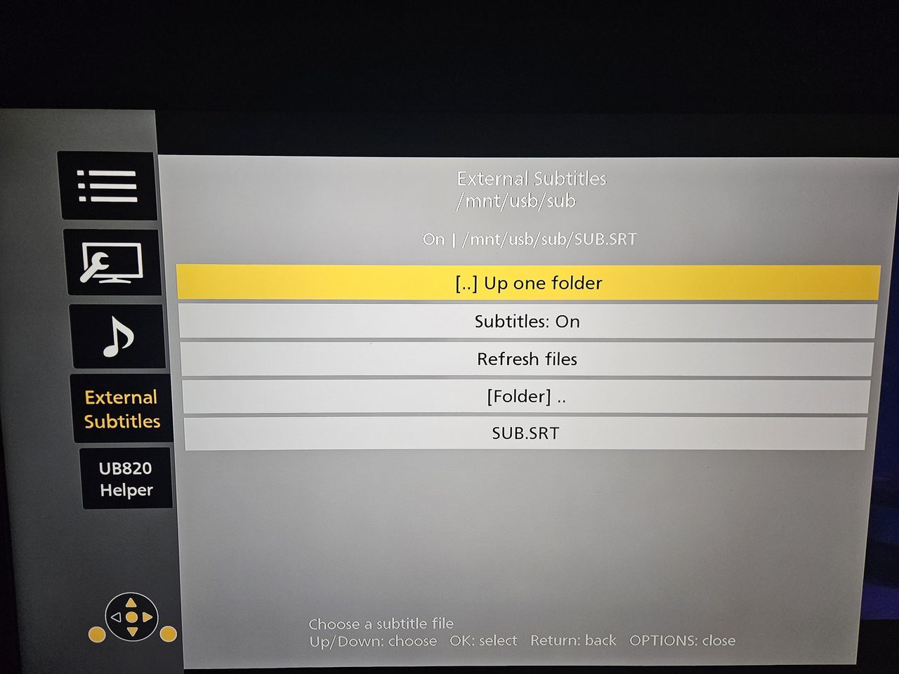

# UB820 Helper

External `.srt` subtitles and extra settings for the **Panasonic DP-UB820**,
supporting firmware **1.82** and **1.85**. It runs in RAM and leaves your
player's firmware untouched; your saved preferences stay on the USB stick.

Choose subtitle files during playback, adjust their size, position, timing and
brightness, and let each Blu-ray remember its own subtitles automatically.
**UB820 Helper** also adds disc region switching, auto power-off control, and
optional diagnostics. Press the **Netflix** button to open Helper over the home
screen, menus or a film, or open **Player Settings > System > UB820 Helper**.

[Download 0.3 and release notes](https://github.com/troleqmaster816/ub820-external-subtitles/releases/tag/v0.3)
· [Configuration](USB-CONTENTS/sub/modules.cfg)

| | |
| --- | --- |
|  |  |
| Browse folders in **OPTIONS > External Subtitles** | The selected subtitle file during a film |

## Setup

You need a **FAT32 USB stick** and a DP-UB820 on firmware **1.82** or **1.85**.
The release ZIP contains everything ready to copy to the stick.

1. Extract the release ZIP to the root of the USB stick (or copy the contents
   of [`USB-CONTENTS/`](USB-CONTENTS)). Keep `LOADER.MKV` right next to the
   `sub` folder.
2. Put your `.srt` files anywhere on the stick — subfolders work. Save them as
   **UTF-8** so accented characters display properly.
3. Start from a clean player boot. If Quick Start is on, unplug the player for
   a few seconds first.
4. Plug in the stick, open **USB > Video**, and launch `LOADER.MKV`. The player
   will say the file cannot be opened — dismiss that message.
5. Play a disc and open **OPTIONS > External Subtitles** to pick a subtitle file.

The helper stays active until the player fully restarts (Quick Start standby
may keep it running). Leave the USB stick plugged in while using external
subtitles or saving settings.

### Updating from an earlier version

Replace **`LOADER.MKV`** and **`sub/engage`** on your stick with the new
files, then fully restart the player before launching the helper again. Keep
your existing `sub/modules.cfg`, saved settings (`sub/ub820_menu.cfg`,
`sub/ub820_subtitles.cfg`), and any SSH files.

## External subtitles

Open **OPTIONS > External Subtitles**, browse to an `.srt` file, and press
**OK**. Subtitles start at the current playback position and automatically turn
on even if you previously turned them off. Selecting the same file again reloads
it. **Subtitles: Off** hides external subtitles without affecting the disc's own
subtitle track.

- **Remembers where you left off:** The browser reopens in the folder of the
  last subtitle file you chose, including after a restart.
- **Per-disc subtitle memory:** Each Blu-ray remembers the `.srt` file you
  chose for it, along with its synchronization and character code (up to 200
  discs, stored in `sub/ub820_subtitles.cfg`). The next time you play that
  disc, your subtitles load automatically instead of `sub/sub.srt`. If the file
  was moved or deleted, it falls back cleanly to `sub/sub.srt`. Delete
  `sub/ub820_subtitles.cfg` to clear saved discs, or set `memory=off` under
  `[external_subtitles]` in `modules.cfg` to disable it. (Applies to Blu-ray
  discs, not DVDs.)
- **Saved position and size:** Changes you make to subtitle **position** or
  **size** in the player's **Subtitle Settings** are remembered automatically
  for future films. English labels fill in missing text on European-language
  menus.
- **Smooth timing:** Fractional subtitle timing is on by default, avoiding the
  player's built-in whole-second stepping.

### Text brightness

Adjust external subtitle brightness from **OPTIONS > External Subtitles**:

- **Left / Right:** step by 1%. **Up / Down:** step by 10%.
- Changes preview live, including while paused.
- **OK:** save. **Return:** cancel and restore the previous brightness.
- **Reset text brightness:** restore and save **Original (100%)**.

Lower values darken the text while keeping its black outline (**0%** draws
black text; use **Subtitles: Off** to hide subtitles). This is independent of
the player's **Subtitle Luminance** setting for disc subtitles.

## UB820 Helper

Open Helper from **OPTIONS**, **Player Settings > System**, or the **Netflix**
button. Press **Netflix** again or **Return** to close it.

<p align="center">
  
</p>

| Setting | What it does |
| --- | --- |
| **Blu-ray region** | Choose **Player default**, **A**, **B**, **C** or **A+B+C**. Takes effect on the next disc launch (eject and reinsert if a disc is already playing). |
| **DVD region** | Choose **Player default**, **No region check**, **Auto** or **1–8**. Note that the drive itself may still block encrypted out-of-region DVDs. |
| **Netflix button** | Open Helper, open Netflix as usual, or do nothing. |
| **Auto power-off** | Keep the player's automatic idle shutdown on, or disable it. Manual power-off still works normally. |
| **CPU optimization** | Experimental option to lower background CPU usage (only shown if enabled in `modules.cfg`). |
| **Start SSH / Stop SSH** | Diagnostic shell access (only shown if enabled in `modules.cfg`). |
| **Helper log / Save log to USB** | View recent helper messages or save them to the USB stick. |

Choices made in the menu are saved to **`sub/ub820_menu.cfg`**. If a USB write
fails, the menu lets you know and you can choose the option again to retry.

## Configuration

Edit [`sub/modules.cfg`](USB-CONTENTS/sub/modules.cfg) to enable or disable
modules or change starting defaults, then restart the player and launch the
helper again. Settings saved through the on-screen menus (`sub/ub820_menu.cfg`)
take priority over `modules.cfg`; delete `sub/ub820_menu.cfg` to go back to
your `modules.cfg` defaults.

Out of the box, external subtitles, Helper menus, region controls, the Netflix
shortcut and logging are enabled; regions stay on **Player default**, text
brightness is **100%**, and auto power-off stays **On**. **SSH, CPU
optimization, and detailed diagnostics are off by default.**

### CPU optimization (experimental)

To show the **CPU optimization** toggle in Helper, add or edit in `modules.cfg`:

```ini
[cpu]
enabled=1
optimize=off
```

Then switch **CPU optimization** to **On** in Helper. If a saved startup
activation does not stay healthy, the helper automatically skips auto-enabling
it on the next boot so you are never stuck in a bad state (you can still turn
it on manually). Tested in short playback sessions on 1.82; not yet tested on
1.85. See the [CPU module documentation](source/modules/cpu/README.md) for
details.

### SSH (diagnostic)

Set `enabled=1` under `[ssh]` in `modules.cfg`, place your public key in
`sub/authorized_keys`, restart the player, and launch the helper. Choose
**Start SSH** in Helper to see the player's address:

```sh
ssh -p 2222 root@PLAYER_IP
```

SSH runs in RAM and disappears on a full restart. Optional password login and
autostart on helper launch are documented in
[`modules.cfg`](USB-CONTENTS/sub/modules.cfg). Only enable SSH on a trusted
network. See [source/tools/ssh/README.md](source/tools/ssh/README.md) for
included tools and details.

### Logging

Use **Save log to USB** in Helper whenever you need a log, or enable continuous
saving in `modules.cfg`:

```ini
[log]
save=always
```

Logs are written to `sub/ub820_submenu.log`, with the previous session kept as
`sub/ub820_submenu.prev.log`. Set `diagnostics=1` to also record crashes, hung
threads and kernel messages.

## Compatibility and limits

- **Firmware 1.82:** primary development and hardware-testing target.
- **Firmware 1.85:** supported, though not every feature has been tested on
  1.85 hardware yet.
- **Firmware 1.84:** not supported.
- **Subtitle files:** must be UTF-8 (BOM optional); up to **64 entries per
  folder** and **250 bytes** per full path.
- **Automatic Blu-ray region (`bd_auto=1`):** experimental and HDMV-only — for
  Java (BD-J) discs, pick a specific region letter instead.

## Troubleshooting

- **Player gets stuck on "Reading" or won't open USB files:** make sure you
  updated **`LOADER.MKV`** to the 0.3 version as well as `sub/engage`, then
  power-cycle the player.
- **Accented letters are missing or cut off the rest of the line:** convert the
  `.srt` file from ANSI / Windows-1250 / Latin-1 to **UTF-8**.
- **Helper is missing from Player Settings:** exit Player Settings and open it
  once more. If it still doesn't appear, power-cycle the player and relaunch
  `LOADER.MKV`.
- **Edits to `modules.cfg` don't take effect:** saved menu settings in
  `sub/ub820_menu.cfg` override `modules.cfg`. Both files are read when the
  helper starts.
- **Something freezes or misbehaves:** save the log if you can, then unplug the
  player for a few seconds and power it back on without launching `LOADER.MKV`
  to return to completely stock firmware.

## Source and license

See [CONTRIBUTING.md](CONTRIBUTING.md) for building from source and module
development. The prebuilt helper is `USB-CONTENTS/sub/engage` (release 0.3).

UB820 Helper is [MIT-licensed](LICENSE). Bundled components keep their own
licenses: [SSH tools and BusyBox](source/tools/ssh/README.md),
[CPU kernel component](source/modules/cpu/kernel/README.md), and
[GNU C Library](source/licenses/README.md).
This is an unofficial project and is not affiliated with Panasonic.
